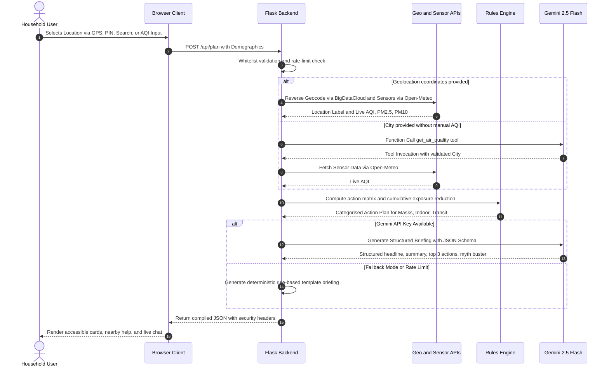

# Clean Air Assistant 🌫️ ➜ 🌤️

[](https://www.python.org/downloads/)
[](https://flask.palletsprojects.com/)
[](#testing)
[](https://ai.google.dev/)
[](LICENSE)

A GenAI-assisted **Urban Air Quality & Exposure Mitigation Assistant** designed for PromptWars Virtual – Challenge 6. It bridges live meteorological sensors and household demographics to produce an actionable, deterministic, and medically safe plan of low-emission routines, indoor air filtration hacks, and quantified exposure reduction estimates.

---

## 🏛️ System Architecture

The system uses a layered, decoupled architecture ensuring that safety and core recommendations never depend on AI availability. If external LLMs or networks fail, the deterministic engine guarantees unbroken, verified guidance.

```mermaid
flowchart TD
    subgraph Client["Frontend Layer (Accessible Web UI)"]
        UI["Single Page Web App (Vanilla HTML5 / CSS3 / ES6)"]
        Map["Interactive Map (Leaflet.js + OpenStreetMap Standard Tiles and Pin Drag)"]
        Geo["HTML5 Geolocation (GPS High-Accuracy)"]
        Typeahead["Typeahead Place Search and Map Sync"]
        VisionInput["Multimodal AQI Image Drop / Paste"]
    end

    subgraph Security["Security and Ingestion Boundary"]
        Gate["Rate Limiter (Sliding Window per IP) and Security Guard"]
        Val["Strict Whitelist Validator (schema, bounds, regex)"]
        SecHeaders["Security Headers (CSP, Nosniff, Frame Deny, Geolocation Perms)"]
    end

    subgraph CoreEngine["Application Core (Flask Engine)"]
        Router["Route Controllers (/api/plan, /api/places, /api/locate, /api/nearby, /api/chat, /api/advisory)"]
        Recommender["Deterministic Rules Engine (Exposure Compounding Formula)"]
        AQIBands["EPA US AQI Classification (6 Bands)"]
    end

    subgraph DataPipelines["Live Data and Geo Services"]
        OpenMeteoAir["Open-Meteo Air Quality API (Live US AQI, PM2.5, PM10)"]
        OpenMeteoGeo["Open-Meteo Geocoding API and OSM Nominatim"]
        BigDataCloud["BigDataCloud Reverse-Geocoding API"]
        Overpass["OSM Overpass API Mirrors (Nearby Help, 10m + 24h Stale Cache)"]
        TTLCache["Bounded In-Memory TTL Caches and Rate Limits"]
    end

    subgraph AIEngine["GenAI Layer (Google Gemini 2.5 Flash)"]
        GeminiClient["REST Client (60s 429 Circuit Breaker, Safety Blocklists)"]
        FCalling["Gemini Function Calling (agent_reading to get_air_quality)"]
        Structured["JSON Schema Constrained Briefing (10m Place-Scoped Cache)"]
        Grounding["Google Search Grounding (Live Official Advisories / GRAP)"]
        Vision["Gemini Multimodal Vision (AQI Screenshot / Sky Clarity)"]
        Chat["Multi-turn Contextual QA (Grounded in Local AQI)"]
    end

    UI -->|JSON over HTTPS| Gate
    Geo -->|Rounded Coordinates| Gate
    Typeahead -->|City or PIN Query| Gate
    VisionInput -->|Base64 Image| Gate

    Gate --> Val
    Val --> Router
    Router --> AQIBands
    Router --> Recommender

    Router --> OpenMeteoAir
    Router --> OpenMeteoGeo
    Router --> BigDataCloud
    Router --> Overpass
    OpenMeteoAir <--> TTLCache
    OpenMeteoGeo <--> TTLCache
    Overpass <--> TTLCache

    Router --> GeminiClient
    GeminiClient --> FCalling
    GeminiClient --> Structured
    GeminiClient --> Grounding
    GeminiClient --> Vision
    GeminiClient --> Chat

    Recommender -->|Compounded Reduction| Router
    Router --> SecHeaders
    SecHeaders -->|Safe JSON Response| UI
```



---

## 🔄 End-to-End Execution Flow



---

## 🎯 Target Audience & Chosen Vertical

Built specifically for households and communities in regions plagued by seasonal or episodic severe smog (e.g., Indo-Gangetic Plains and global metros):
- **High-Risk Personas**: Households with infants/children, geriatric family members, pregnant women, and individuals diagnosed with asthma, COPD, or cardiovascular conditions.
- **Commuter Segments**: Pedestrians, cyclists, two-wheeler riders, open transit commuters, and car passengers.
- **Indoor Environments**: Households relying on biomass/chulha fuels vs. LPG/electric, homes with HEPA purifiers vs. natural ventilation.

---

## 🧠 Core Engineering Principles

### 1. Deterministic Safety Core + GenAI Enrichment
- **Medical & Practical Integrity**: Health-critical advice (e.g., N95 seal recommendations, timing shifts, DIY Corsi-Rosenthal boxes) is generated strictly by deterministic algorithms in `app/recommender.py`. It is never hallucinated by an LLM.
- **Mathematical Compounding Formula**: Multi-layered precautions are combined non-linearly to prevent impossible reductions:
  $$\text{Exposure Reduction} = 1 - \prod_{i=1}^{n} (1 - r_i) \quad \text{capped strictly at } 85\%$$
- **GenAI Role**: Gemini enriches the advice by writing accessible, culturally nuanced, and multilingual daily briefings, answering follow-up questions, and interpreting visual evidence.
- **Reading Freshness & Source**: Under the AQI gauge, plans display the reading source (`Open-Meteo`, `Entered by you`, or `Read from your screenshot`), the upstream reading time in the browser's local timezone with relative age (flagging readings older than 3 hours), and `PM2.5` / `PM10` readings when available.

### 2. Seven Integrated Gemini Capabilities

| Capability | Module & Implementation | Fallback / Error Behavior |
|---|---|---|
| **System Instructions & Safety Settings** | `app/gemini.py` / `ai.py`: Enforces domain scope, non-diagnosis policy, and `BLOCK_MEDIUM_AND_ABOVE` safety blocklists. | Built-in deterministic rules engine (`recommender.py`) and strict input validation (`validation.py`). |
| **Function Calling** | `ai.agent_reading`: Gemini selects `get_air_quality` for city queries; args undergo `valid_city` whitelist validation. | Direct Open-Meteo lookup (`fetch_reading` / `fetch_reading_coords`); on failure, HTTP 502 `"{exc}. You can enter the AQI manually."`. |
| **Structured JSON Briefing** | `ai.briefing`: Enforced with `responseSchema` (`headline`, `summary`, `top_three`, `myth_buster`). | Localized rule-based template briefing (`ai.template_briefing`, `source: "rules"`) with English fallback. |
| **Multilingual Output** | `ai.briefing` / `ai.chat` / `ai.local_advisory` & rule catalogs: Supports English, Hindi, Telugu, Tamil, Bengali, and Marathi (machine-assisted translations, not guaranteed expert-reviewed; not full UI localization). | Localized template briefing (`en` fallback) for plans; `err.*` messages localize on 502, while rate-limit (429), 400, missing-key (503), and `/api/image-aqi` errors stay English. |
| **Google Search Grounding (Advisories)** | `ai.local_advisory`: Discovers live government advisories (e.g., GRAP stages, school/construction curbs) with cited HTTPS URLs. | Missing key (503): `"This AI feature needs a Gemini API key on the server."` · 429 (502): `"AI features are temporarily unavailable. The rule-based plan is still shown."` · Other failure (502): `"Could not fetch advisories right now."` |
| **Image Reading** | `ai.read_image`: Multimodal vision extracts AQI from screenshots or gauges visibility from sky photos (`aqi: null` if unreadable). | Missing key (503): `"This AI feature needs a Gemini API key on the server."` · 429 (502): `"AI features are temporarily unavailable. The rule-based plan is still shown."` · Other failure (502): `"Could not read that image."` |
| **Multi-turn Chat** | `ai.chat`: Context-aware follow-up Q&A grounded in the user's current place and AQI. | Missing key (503): `"This AI feature needs a Gemini API key on the server."` · 429 (502): `"AI features are temporarily unavailable. The rule-based plan is still shown."` · Other failure (502): `"The assistant is unavailable right now."` |

*(Note: **Nearby clean-air help** results come from OpenStreetMap through public Overpass servers with mirrors and a 24-hour stale cache; the card falls back to a map link when the servers are busy, and opening hours and mask stock are not verified.)*

### 3. Transparent Location Detection Engine

The client location engine (`app/static/locate.js`) listens for the most accurate fix over a settling window of up to 20 seconds, stopping early once high precision is reached.
- **Honest Accuracy Reporting**: Mobile phones with hardware GPS receivers typically achieve satellite precision ($\le 150\text{ m}$), while laptops and desktop PCs without GPS chips estimate position from Wi-Fi/IP network signals. The interface honestly reports the uncertainty radius.
- **Quality Tiers**:
  - `precise` ($\le 150\text{ m}$): High-precision satellite/device fix. Automatically centers map and triggers plan.
  - `good` ($\le 1.5\text{ km}$): Neighborhood-level accuracy.
  - `approximate` ($\le 5\text{ km}$): Suburb/metro network estimate.
  - `coarse` ($> 5\text{ km}$): Wide area guess. Coarse fixes are never saved to `localStorage` and never overwrite a pinned place.
- **Privacy & 24h Expiry**: Saved places expire and are cleared after 24 hours. A "Forget saved location" button allows manual removal at any time.
- **Precision Fallbacks**: For exact street-level coordinates on laptops, users can type their 6-digit Indian PIN code (geocoded via OpenStreetMap Nominatim) or click/drag the red map pin to their exact home or workplace.

---

## 📂 Project Structure

```
clean-air-assistant/
├── .github/
│   └── workflows/
│       └── ci.yml          # CI checks: ruff, flake8, interrogate, radon, pylint, coverage, Node tests & ESLint
├── app/
│   ├── __init__.py         # Application factory, CSP & security response headers
│   ├── routes.py           # HTTP endpoints and guard checks
│   ├── rate_limit.py       # In-memory per-IP sliding-window rate limiter
│   ├── shared.py           # Shared bounded-cache, rounding, User-Agent, and language constants
│   ├── validation.py       # Strict payload, coordinate, regex, and magic-byte validators
│   ├── air_data.py         # Multi-service sensor ingestion, geocoding & reverse geocoding
│   ├── aqi.py              # EPA US AQI classification scale (0-500, 6 severity bands)
│   ├── i18n.py             # Offline localization helpers with English fallback
│   ├── locales/            # Machine-assisted 6-language catalogs (en, hi, te, ta, bn, mr; not guaranteed expert-reviewed)
│   ├── recommender.py      # Rules engine & mathematical exposure reduction formula
│   ├── gemini.py           # Robust REST client (auto-loads .env, safety, timeouts)
│   ├── nearby.py           # OpenStreetMap nearby places (Overpass mirrors, 30s deadline, 10m + 24h stale caches, 1 req/2s & daily cap)
│   ├── ai.py               # 7 GenAI capability implementations & localized deterministic fallbacks
│   └── static/             # Pure Vanilla frontend (plain deferred IIFE scripts, no build tools)
│       ├── index.html      # Accessible semantic HTML5 layout with ARIA landmarks (static form labels stay English)
│       ├── style.css       # Responsive design, light/dark themes, accessible focus contrast, reduced-motion
│       ├── locate.js       # Client-side settling location engine (CleanAirLocate)
│       ├── i18n.js         # Machine-assisted dynamic UI translations & lang tagging (CleanAirI18n; not full UI localization)
│       ├── reading.js      # Reading source, local timestamp, age & PM formatter (CleanAirReading)
│       ├── dom.js          # Shared DOM/SVG helpers, constants, and JSON fetch wrapper (CleanAirDom)
│       ├── plan_view.js    # Plan payload builder, SVG AQI gauge, skeleton & cards (CleanAirPlanView)
│       ├── map_location.js # Interactive Leaflet map, pin drag, and localStorage state (CleanAirMap)
│       ├── search_box.js   # City/PIN combobox autocomplete and keyboard navigation (CleanAirSearch)
│       ├── extras.js       # Image upload, advisories, chat, and nearby help panels (CleanAirExtras)
│       ├── app.js          # Top-level coordinator binding form submission and modules
│       ├── pin.svg         # Self-hosted SVG map pin icon
│       ├── leaflet.js      # Vendored Leaflet 1.9.4 library
│       ├── leaflet.css     # Vendored Leaflet 1.9.4 stylesheet
│       └── leaflet.LICENSE # Vendored Leaflet BSD-2-Clause license
├── docs/
│   └── DECISIONS.md        # Architecture decision records
├── tests/
│   ├── __init__.py
│   ├── helpers.py          # Shared offline test base class and socket guard
│   ├── locate.test.js      # 11 unit tests for location engine settling & thresholds
│   ├── reading.test.js     # 5 unit tests for reading time, stale warning, i18n & PM formatting
│   ├── ui.test.js          # 10 unit tests for pure DOM/payload/gauge/search/a11y/i18n/CSS helpers
│   ├── test_ai_routes.py   # 13 tests for AI HTTP routes (/api/image-aqi, /api/advisory, /api/chat)
│   ├── test_air_data.py    # 24 tests for place search, Nominatim throttle, geocoding & reading metadata
│   ├── test_gemini.py      # 17 tests for Gemini REST client, breaker, fallback & capabilities
│   ├── test_hygiene.py     # 4 tests for DOM XSS sinks, inline HTML assets, key prefixes & repo size
│   ├── test_i18n.py        # 8 tests for 6-language catalogs, rules, briefings, punctuation & localized route fallbacks
│   ├── test_nearby.py      # 18 tests for OpenStreetMap Overpass & caches
│   ├── test_recommender.py # 8 tests for AQI bands & rules engine
│   ├── test_routes.py      # 13 tests for core HTTP routes, CSP & rate limiter
│   └── test_validation.py  # 6 tests for payload, city & image validation
├── .editorconfig           # Editor indentation and line-ending rules
├── .env.example            # Environment template for keys, models & nearby daily cap
├── .flake8                 # Flake8 line-length and exclude settings
├── .gitattributes          # Line-ending normalization rules
├── .gitignore
├── ARCHITECTURE.md         # Module map and primary request flow
├── Dockerfile              # Single-stage Python 3.12-slim production container
├── eslint.config.js        # ESLint flat config for first-party browser scripts
├── LICENSE                 # MIT License
├── Procfile                # Process definition for Gunicorn deployment
├── pyproject.toml          # Ruff, Interrogate, and Pylint tool configuration
├── requirements.txt        # Production dependencies (Flask, Requests, Gunicorn)
├── requirements-dev.txt    # Pinned production, test, lint, and coverage dependencies
├── README.md               # Technical architecture and developer guide
├── SECURITY.md             # Implemented security controls, known limits & reporting
└── TESTING.md              # Offline test suites, coverage & CI quality gates
```

---

## 🔒 Security & Privacy Architecture

- **Privacy-Preserving Geolocation**: For `POST /api/plan` (`fetch_reading_coords`) and `POST /api/nearby`, backend coordinate lookups round latitudes and longitudes to $\approx 1\text{ km}$ ($0.01^\circ$); `GET /api/locate` (and the `_resolve_display_place` fallback on `"Your location"`) sends exact browser/map query coordinates to BigDataCloud for reverse-geocoding.
- **Strict Content Security Policy (CSP)**:
  `default-src 'self'; script-src 'self'; style-src 'self'; img-src 'self' data: https://tile.openstreetmap.org; connect-src 'self'; frame-ancestors 'none'; base-uri 'none'; form-action 'self'`
- **Zero XSS**: Frontend renders exclusively via safe DOM properties (`textContent`, DOM nodes); never parses unsanitized `innerHTML`.
- **Sliding-Window Rate Limiting**: In-memory IP-based rate limiting (maximum 30 requests per minute per IP via `ProxyFix(x_for=1)`) prevents API abuse.
- **Strict Body Caps & Magic Bytes**: JSON payloads are capped at 8 KB; image uploads are limited to 5 MB and validated against PNG/JPEG/WEBP magic bytes.

---

## 🚀 Getting Started

### Prerequisites
- Python 3.11+
- Git

### 1. Installation
```bash
# Navigate into the project directory
cd clean-air-assistant

# Install production and development dependencies
pip install -r requirements-dev.txt
```

### 2. Environment Configuration
Create a `.env` file in the project root:
```env
# Optional: The application operates completely out of the box without a key via rules.
# Adding a key activates all 7 live Gemini capabilities (default model: gemini-2.5-flash).
GEMINI_API_KEY=your_gemini_api_key_here
GEMINI_MODEL=gemini-2.5-flash
# Optional fallback model on 429/503 for non-Search calls (empty = disabled; quotas are per model)
GEMINI_FALLBACK_MODEL=

# Contact email or repo URL for Nominatim/Overpass User-Agent header (defaults to repo URL)
CONTACT_EMAIL=your contact email or repo URL
```
Free-tier keys have low daily limits; when the limit is reached the app shows its rule-based plan. Using `GEMINI_FALLBACK_MODEL` takes advantage of separate per-model quotas for non-Search features (briefing, chat, image reading, and function calling).

### 3. Run Development Server
```bash
python -m flask --app "app:create_app" run
```
Navigate to `http://127.0.0.1:5000` in your web browser.

---

## 🧪 Testing

The test suite uses Python's standard-library `unittest` and Node's built-in `node --test` runner (not `pytest`, which is only an optional dependency in `requirements-dev.txt`). It covers validation boundaries, rules engine logic, coordinate fuzzing, place resolution, API error responses, Nominatim throttling, rate limiting, OpenStreetMap nearby places (Overpass API, no key), and location engine settling.

Run Python test suite:
```bash
python -W default -m unittest discover -s tests -t .
```
Output:
```text
Ran 111 tests

OK
```

Run Node.js test suites for location, reading, and UI helpers:
```bash
node --test tests/
```
Output:
```text
# tests 26
# suites 0
# pass 26
# fail 0
```

### Code Quality
- **Static analysis (`ruff`, `flake8`, & `eslint`)**: `0` findings across `app`, `tests`, and first-party `app/static/` (configured in `pyproject.toml`, `.flake8` with max line length `120`, and `eslint.config.js`); `pylint app` rated `9.90 / 10`.
- **Modularity & complexity**: `0` functions above Cyclomatic Complexity `10` (`radon cc -s -n C app`), `0` Python functions or first-party JS function bodies above `40` lines, and all first-party JS modules are plain deferred IIFEs with `0` `innerHTML` usage.
- **Documentation, coverage & typing**: `interrogate app` `100.0%` (`136/136` items documented); `94%` Python line coverage across `app/` (`coverage run --source=app`: `1074` statements, `65` missed); `100.0%` parameter and return type annotations across `app/` (`105/105` functions).
- **Multilingual scope (6 languages — machine-assisted translations, not guaranteed expert-reviewed)**: rule-based plans, actions, safety notes, template briefings, default place fallbacks, dynamic card/reading/advisory/nearby headings (`lang` attributes set via `textContent`), and `lang`-aware route error messages (`err.*`) follow `en`, `hi`, `te`, `ta`, `bn`, and `mr` (partial output localization, not full UI localization); static form labels in `index.html`, geolocation/search status text, rate-limit (`429`) and `400` error messages, `/api/image-aqi` error text, missing-key (`503`) responses, and distance units (`m`/`km`) stay English.

---

## 📚 Documentation

- [ARCHITECTURE.md](ARCHITECTURE.md) — backend/frontend module map and primary `/api/plan` flow
- [SECURITY.md](SECURITY.md) — implemented security headers/validators, known limitations, and reporting contact
- [TESTING.md](TESTING.md) — offline test suites, socket guards, coverage metrics, and CI gates
- [docs/DECISIONS.md](docs/DECISIONS.md) — architectural rationale and trade-offs

---

## 🌐 External Data Sources

Every outbound `https://` endpoint contacted by the app (`app/*.py` and `app/static/*.js`, excluding vendored Leaflet) and the data transmitted to each:

1. **Open-Meteo Air Quality API (`https://air-quality-api.open-meteo.com/v1/air-quality`)** – Fetches live hourly `us_aqi`, `pm2_5`, and `pm10`. **Data sent:** latitude and longitude rounded to $0.01^\circ$ ($\approx 1\text{ km}$) for geolocation/map picks (or geocoded city coordinates).
2. **Open-Meteo Geocoding API (`https://geocoding-api.open-meteo.com/v1/search`)** – Powers typeahead place search and city coordinate lookup. **Data sent:** typed city/place query text, result limit, and `language=en`.
3. **BigDataCloud Reverse Geocoding API (`https://api.bigdatacloud.net/data/reverse-geocode-client`)** – Converts picked/detected coordinates into human-readable city and region labels with zero server persistence. **Data sent:** latitude and longitude rounded to $0.01^\circ$ ($\approx 1\text{ km}$) when called via `fetch_reading_coords`, or exact query coordinates when called via `GET /api/locate` (and the `_resolve_display_place` `"Your location"` fallback), plus `localityLanguage=en`.
4. **OpenStreetMap Nominatim (`https://nominatim.openstreetmap.org/search`)** – Geocodes 6-digit Indian PIN codes and explicit Enter-key searches, protected by a 1-request/second thread-safe throttle and `countrycodes=in`. **Data sent:** search query text (`q`), `countrycodes=in`, and `User-Agent` containing `CONTACT_EMAIL` or the repository URL.
5. **OpenStreetMap Overpass Mirrors (`https://ovp.dresel.systems/api-as/interpreter` and `https://maps.mail.ru/osm/tools/overpass/api/interpreter`)** – Finds nearby hospitals, clinics, pharmacies, libraries, and malls within 4 km for `/api/nearby` (with a 30s deadline, 1-request/2-second throttle, UTC daily cap `NEARBY_DAILY_CAP` default 80, 10-minute fresh cache, and 24-hour stale-if-error cache; opening hours and mask stock are not verified). **Data sent:** Overpass QL query with coordinates rounded to $0.01^\circ$ ($\approx 1\text{ km}$) and `User-Agent` containing `CONTACT_EMAIL` or the repository URL.
6. **OpenStreetMap Tiles & Links (`https://tile.openstreetmap.org/{z}/{x}/{y}.png` & `https://www.openstreetmap.org/...`)** – Browser fetches standard map tiles via Leaflet; clicking a nearby place or fallback area link opens `www.openstreetmap.org` in a new tab. **Data sent:** tile requests directly from the browser expose the viewed tile coordinates (`z/x/y`) and visitor IP address to OpenStreetMap tile servers, subject to the [OpenStreetMap Tile Usage Policy](https://operations.osmfoundation.org/policies/tiles/) (for light evaluation/demo use; high-volume production deployments should use a dedicated keyed tile provider).
7. **Google Gemini API (`https://generativelanguage.googleapis.com/v1beta/models/{model}:generateContent`)** – Powers structured briefings, vision reading, Google Search grounded advisories, function calling, and follow-up chat when `GEMINI_API_KEY` is configured. **Data sent:** system prompt, `x-goog-api-key` header, and feature-specific context (`city`, `place`, AQI, action titles, user chat question + up to 6 turns of history, or uploaded PNG/JPEG/WebP image).

---

## 📄 License
This project is open-source and distributed under the [MIT License](LICENSE).
